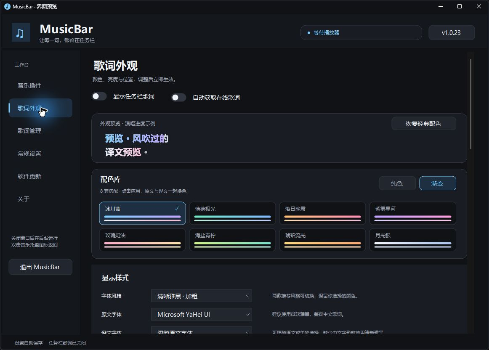

# MusicBar · Windows 任务栏歌词

MusicBar 是一款免费开源的 Windows 音乐歌词工具，提供中文设置界面，将桌面歌词显示在任务栏中。支持 QQ 音乐、网易云音乐、逐句译文、长句滚动和歌词外观设置，采用 MIT 许可证。

[下载最新版本](https://github.com/xudd2025-collab/MusicBar/releases/latest) · [更新记录](CHANGELOG.md) · [参与开发](CONTRIBUTING.md)

## 界面展示

### 双行歌词效果

软件内置演唱进度预览，展示原文、译文和渐变效果。


### 外观与配色库



## 安装

从 Releases 下载 `MusicBar-Setup-1.0.23.exe`，按向导安装。默认安装到当前用户目录，无需管理员权限。也可下载 `MusicBar-Portable-1.0.23.zip`，解压到可写目录后运行 `MusicBar.exe`。

需要 Windows 10 1809 及以上 / Windows 11、.NET Framework 4.8。构建和实机验证环境为 Windows x64。

安装和升级保留 `data/` 设置和缓存。卸载后保留用户数据，需要彻底清理时可自行删除安装目录中的 `data/`。发布包不含个人歌词缓存、账号信息或开发诊断程序。

## 使用

1. 在「音乐插件」启用 QQ 音乐或网易云音乐，然后播放歌曲。
2. QQ 音乐通过 Windows 系统媒体会话（SMTC）接入，可直接打开播放器。
3. 网易云首次点击「启动网易云接入」，会备份并修复现有快捷方式后启动播放器。若普通启动后只显示歌名，点击「修复并启动接入」，再从网易云托盘退出一次，MusicBar 会自动重新打开接入。工具会备份原快捷方式，为桌面、开始菜单和已固定的启动入口保留接入参数，并提供「网易云音乐（任务栏歌词）」桌面入口；可在同页还原。也可直接按「启动网易云接入」。
4. 在「歌词外观」选择清晰雅黑或轻盈等线，也可自选原文、译文字体；译文默认跟随原文，两款推荐风格同时应用于两行并保留自定义颜色。西文字体缺少中文字形时采用清晰雅黑。「应用推荐配色」单独恢复柔蓝、灰蓝配色与 100% 亮度。原文和译文的未唱、已唱颜色均可独立选择。解锁后可拖动歌词，也可用左右按钮微调。
5. 自动匹配失败时，在「歌词管理」选择对应版本，或导入带时间标记的 `.lrc`。

关闭主窗口后继续在托盘运行。双击音乐托盘图标打开设置，使用「退出 MusicBar」完全退出。「常规设置」可开启随 Windows 登录启动，默认关闭。

「常规设置」可隐藏任务栏及托盘应用图标，重启后继续生效；再次运行程序也能打开设置。默认全局快捷键 `Ctrl + Alt + M` 切换设置窗口显示与隐藏，隐藏后歌词继续同步。点击快捷键输入框，直接按 F1、F2 等单个功能键，或按 Ctrl / Alt 加其他键，再点「保存快捷键」；支持恢复默认和关闭。新快捷键被系统或其他软件占用时不保存，原快捷键继续有效。

## 软件更新

右上角显示当前版本，发现更高的稳定版本后显示红色提示点，点击进入「软件更新」。默认启动后检查，每 6 小时复查；检查失败后 15 分钟重试，网络恢复时提前重试。可在「常规设置」关闭自动检查，仍可手动检查。

更新信息来自本仓库 GitHub Releases、GitHub 原始文件，以及 jsDelivr 的普通和 Fastly 线路。各线路并发检查并选择最高版本，避免旧 CDN 缓存覆盖已发现的新版本。断网时保留已发现的新版提示，不会把检查失败显示为「已是最新」。

点击「下载并安装」后，先使用 GitHub Release 下载；失败或 SHA-256 不匹配时切换到 `updates` 分支及其 CDN 备用线路。下载时显示蓝色圆角进度与百分比。下载完成并校验通过后自动打开安装向导，再退出 MusicBar，无需第二次点击；已校验的安装包可复用。下载、校验或向导启动失败时保留应用并提示重试。自动检查只发现更新，安装仍由用户点击此按钮发起。更新安装到当前程序目录，保留设置，音乐播放器继续运行。

维护者的发布流程同步上传备用文件。CDN 有缓存和可用性限制，多线路不能保证所有网络下始终可达。所有线路失败时可以稍后重试或打开发布页。

更新检查只访问版本文件，不发送歌名、歌手或本机文件。配置位于 `update-source.json`，格式为 `{"repository":"owner/MusicBar"}`。只接受该仓库的 GitHub HTTPS 地址、GitHub 官方发行重定向和指定 CDN 路径。

## 歌词同步与显示

- 使用播放器报告的真实进度。暂停、恢复和拖动时重新同步，已递增的原生进度不叠加旧时间戳的时长。
- 正数时间偏移提前显示，负数延后；偏移不改变音乐速度。
- 长句原文和译文分别从头滚到末尾一次，停在末尾，下一句开始时复位。暂停恢复同句不会重滚。
- 「歌词外观」的「每行最多字数」可输入 0–200，0 为不限；原文和译文分别计数，空格与标点也计入。同一句原文和译文按原文演唱进度一起切换片段，两行均遵守上限；暂停停留在所在片段，拖动进度同时重新定位。关闭逐字变色后仍可使用。设置立即生效并保存，完整歌词和时间轴保留。
- 有可同步译文时，第二行显示当前句译文。没有译文或没有可用译文时间轴时显示具体状态，不生成翻译。
- 「歌词外观 → 配色库」提供冰川蓝、薄荷极光、落日晚霞、紫雾星河、玫瑰奶油、海盐青柠、琥珀流光、月光银 8 套搭配，可切换纯色或渐变。点击色卡同时应用原文与译文颜色，预览和任务栏立即更新；「恢复经典配色」可回到原有纯色搭配。
- 原文、译文可分别设置未唱、已唱及渐变尾色。单色选择器内有 32 个命名颜色、最近使用和 HEX/RGB 自定义，确认后保存，取消不改变现有配色。渐变固定在整句上，不随演唱边界改变；关闭逐字变色后显示整行渐变。逐字变色跟随播放器位置；有可用逐字时间戳时按时间戳，只有逐句歌词时按句内进度估算。暂停冻结、拖动重新定位。
- 首次启动显示原作者声明，任务栏歌词旁和设置窗口标注「免费开源」及作者 xudd2025-collab。点击进入作者 GitHub 项目，内嵌页面成功加载后可永久关闭提示和水印；只在本机保存关闭状态。暂不访问时保留水印，可从设置窗口底部再次打开作者提示。页面无法加载时不会解锁，不影响歌词功能。
- 作者项目页使用微软 Edge WebView2 运行时；没有运行时的电脑会提示安装微软官方运行时。只有主动点击进入项目才加载网页，页面使用独立的本机浏览数据目录，不修改其他浏览器的登录。附带 SDK 的许可见 `third-party/WebView2/`。
- 默认加粗歌词并减轻描边，可在「字体清晰度」关闭加粗。
- 亮度范围 30%～160%，新配置默认 100%；提亮保留所选颜色的色相，达到最大亮度后不再继续增益，避免浅色全部变白。双行按实际字形和任务栏可用高度适配。
- 默认避开任务栏按钮；空间小可改为在任务栏上方显示。支持拖动、左右微调、多显示器和位置保存。
- 任务栏隐藏、无任务栏的显示器或前景应用全屏时隐藏歌词。
- 在线匹配保留歌曲版本、歌手、专辑和时长校验；QQ 仅报告首位歌手时，只在严格校验后采用唯一候选。
- QQ 歌名、专辑译名及歌手括号别名统一处理；正式译名来自平台返回的数据。QQ 接口受限时尝试同一录音的网易云备用歌词，成功后缓存原文、译文和匹配结果。
- 使用 QQ 备用歌词时，后台继续核对 QQ 公开专辑目录；确认当前录音后，将原文、译文和逐字时间一起换回 QQ 来源，避免两平台的时间及翻译差异。现有备用绑定也会自动补查，成功后后续播放直接复用 QQ 缓存；切歌取消补查，手动选择的歌词优先。
- QQ 的日文／英文双语专辑名可按括号内的显示名称核对，例如「ペニーレイン (Penny Rain)」与「Penny Rain」。此规则要求歌名、歌手、专辑、时长和唯一候选完整通过校验，不去掉现场、限定盘等版本标签；无歌词时的歌曲信息不受每行字数限制。
- QQ 普通歌词为空或只有纯文字时，自动读取同一歌曲编号的原生 QRC 逐字歌词；识别十六进制编码、压缩格式及逐行、逐字时间标记，已有纯文字缓存也会自动补齐时间轴。时间标记来自平台，不按文字长度生成。
- LRC 支持 UTF-8 / BOM / GBK、多时间标签、毫秒与 offset；无时间标签的文本不能同步。

### 网易云接入

已适配网易云 `3.1.41.205529`。该版本 SMTC 时间轴可能为零，工具通过播放器自带本机浏览器接口读取原始进度和歌曲记录，校验歌曲 ID、时长和状态，并按歌曲 ID 直接获取歌词。客户端原生进度约每秒更新一次；确认正常递增后，在两次样本之间进行短时平滑，预测最多 1.2 秒，重复读取不会刷新时间锚点。暂停、切歌和拖动以新读到的原生状态重新定位。

入口以调试参数启动当前网易云，接口只监听 `127.0.0.1:9223`。工具核对端口归属后读取播放器页面信息，不修改播放器安装文件，也不读取账号凭据。「修复网易云启动方式」让现有快捷方式在下次打开时继续带上参数；直接运行 `cloudmusic.exe` 或播放器更新后新建的入口仍可能不带参数，需要使用接入入口或再次修复。短暂重连最多保留同一歌曲信息两秒，期间冻结进度；长期缺少接口时显示接入提示。客户端升级改变内部控件时可能需要重新适配。

## 数据与网络

程序旁 `data/` 存放设置、网易云路径、手动歌词绑定、歌词和匹配缓存、更新缓存与已下载安装文件。便携目录必须可写。

成功获取的歌词、译文、时间轴和自动匹配记录会保存在本地；关闭窗口、退出软件、重启和升级均保留，不按保存天数失效。已缓存歌曲优先读取本地，关闭「自动获取在线歌词」后仍可使用可靠匹配的已有缓存。可在「歌词管理 → 本地歌词缓存」查看歌词数量和占用，点击「清理歌词缓存」手动清理。清理只移除自动歌词及自动匹配缓存，保留手动导入／选择的歌词、全部设置和当前正在显示的歌词。

自动获取歌词会向 QQ 音乐 / 网易云公开接口发送歌名和歌手。关闭「自动获取在线歌词」后可使用本地歌词及已有缓存，搜索和手动在线获取也停止。平台接口可能变化或受网络限制。歌词版权归权利人所有，本项目不附带歌词文件。

## 构建

使用 Windows 自带 .NET Framework C# 编译器和 WinRT 元数据。首次构建会从微软官方 NuGet 源还原固定版本的 WebView2 SDK `1.0.2903.40`，需要联网，无需另装 NuGet 工具：

```powershell
.\build.ps1 -Check
.\checks\Run-OverlayChecks.ps1 -RenderOnly
```

还原脚本 `Restore-WebView2.ps1` 核对包的 SHA256（`EF128016DD1E51C59178C827ED5B8AA3322C57AFA8675D930F8109505542AD74`），仅提取构建所需的两个托管 DLL、三种架构的加载器及许可文件，并逐个核对文件哈希；校验失败即停止。已有 SDK 文件校验通过后直接复用，不替换文件，也无需联网。SDK 保存在忽略提交的 `.tools/webview2/`，它不包含 Edge WebView2 浏览器运行时。

正式程序为 `release/MusicBar.exe`，须同时保留生成的配置文件、WebView2 DLL、`runtimes/` 和 `third-party/` 文件。生产源码使用明确清单，开发检查输出至 `checks/.build/`，检查入口不编入正式应用。被安全软件拦截的独立检查继续暂停，详情见 `SECURITY.md`；`-Check` 会明确提示这一限制。

安装包需要官方 Inno Setup 6 或 7（含简体中文语言文件）：

```powershell
.\installer\Build-Installer.ps1 -CompilerPath 'C:\Program Files (x86)\Inno Setup 6\ISCC.exe'
```

输出 `dist/` 的安装向导、干净便携 ZIP、更新清单与 `SHA256SUMS.txt`。打包脚本只复制明确列出的运行文件，不复制 `data/`。

维护者更新版本后推送 `v版本号` 标签，GitHub Actions 会构建、检查、发布资产并同步备用分支和更新清单。手动发布后也可运行 `installer/Publish-Update.ps1 -Repository owner/MusicBar` 同步备用线路。脚本需要对该公开仓库有写权限的 GitHub CLI 登录。

## 安全与贡献

安装包尚未代码签名。SHA-256 用于核对下载是否与发布文件一致，无法代替代码签名。开发诊断曾被安全软件拦截，说明见 [SECURITY.md](SECURITY.md)；发布资产不包含诊断 EXE。

QQ 音乐、网易云音乐名称仅说明适配对象，本工具是独立第三方应用。

暂停时默认隐藏歌词，恢复播放后自动显示；可在「歌词外观」关闭「暂停时隐藏歌词」以保留当前行。首次读取 QQ 歌词会并行检查普通及逐字格式，并复用译文请求，已缓存歌曲直接读取本地。

QQ 首次匹配会在普通搜索开始后 150 毫秒启用严格匹配的备用来源，并在 350 毫秒内加入原平台公开目录；哪个入口先取得可靠时间轴就先显示，成功后取消较慢请求。整体查找限时 6.5 秒，避免受限的普通搜索导致长时间只显示歌名。目录接受播放器只显示主歌手的情况，同时继续核对歌名、原生专辑、时长与唯一录音，拒绝无法确认的版本。
